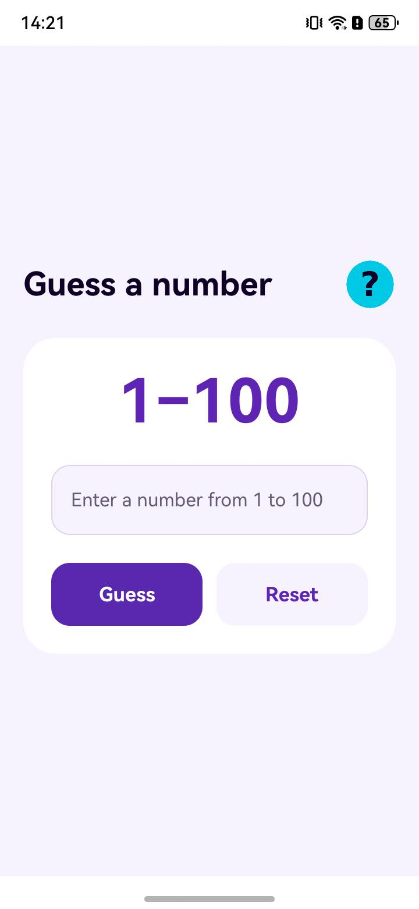

# GuessNumber

A local number guessing example for OpenHarmony phones and tablets.

## What this example demonstrates

| Capability | API or platform service | Where to look |
| --- | --- | --- |
| Choose a random number from 1 to 100 | `Math.random()` | [numberUtils.ets](entry/src/main/ets/utils/numberUtils.ets) |
| Accept whole-number guesses, including the keyboard's Go action, and show higher or lower hints | ArkUI `TextInput`, `Button`, and `@State` | [Index.ets](entry/src/main/ets/pages/Index.ets) |
| Show rules and a win dialog, with a distinct card for wins in five tries or fewer | ArkUI `CustomDialogController` and `@CustomDialog` | [Index.ets](entry/src/main/ets/pages/Index.ets) and [infoComponent.ets](entry/src/main/ets/component/infoComponent.ets) |
| Display English and Chinese text | OpenHarmony string resources | [English](entry/src/main/resources/en_US/element/string.json) and [Chinese](entry/src/main/resources/zh_CN/element/string.json) |

## Preview



## Requirements

- An OpenHarmony phone or tablet to run the app. The project compiles and targets API 23 and declares compatibility with API 20 and later.
- Node.js 20 or later and a JDK. The [build workflow](.github/workflows/build.yml) uses Java 17 and `@oniroproject/oniro-app` 0.10.0 with OpenHarmony SDK 6.1.
- Local development signing for installation. No app permissions, account, or external service are required.

## Build and run

From the repository root, install the tools and create the ignored local signing profile:

```sh
npm install --global @oniroproject/oniro-app@0.10.0
oniro-app sdk install 6.1
oniro-app cmdtools install
cp build-profile.example.json5 build-profile.json5
oniro-app sign
oniro-app build --product default --module entry
```

The signed package is `entry/build/default/outputs/default/entry-default-signed.hap`. The generated `build-profile.json5`, `signatures/`, and `.local-signing/` are ignored by Git. With a connected device, install and launch it from the repository root:

```sh
oniro-app app install
oniro-app app launch
```

## Use

Enter a whole number from 1 to 100 and tap **Guess** or use the keyboard's **Go** action. Use the higher or lower hint to try again. Tap **Reset** to start a new round, or the question-mark icon to read the rules. A correct guess shows a win card and the attempt count; close it to start another round.

## Explore the implementation

[EntryAbility.ets](entry/src/main/ets/entryability/EntryAbility.ets) loads the game page. [Index.ets](entry/src/main/ets/pages/Index.ets) holds the round state, validates and counts guesses, and displays hints and the win dialog. [numberUtils.ets](entry/src/main/ets/utils/numberUtils.ets) chooses the answer, while [infoComponent.ets](entry/src/main/ets/component/infoComponent.ets) displays the rules.

## Verify

Build the app with the command above. On a device, try an empty guess, 0, and 101 to check validation; enter valid guesses to check the higher or lower hint; then confirm the win card and attempt count. Check **Reset**, the rules dialog, the keyboard's **Go** action, and both English and Chinese device languages. A win within five attempts uses the highlighted win card.

## Contributing

These apps are focused examples of specific platform capabilities. Contributions that keep an example correct, buildable, and clear are welcome, including bug fixes, documentation and setup corrections, and improvements to its existing behavior. Please keep pull requests within the app's stated purpose and describe how you verified the change.

**Found a problem but can't fix it?** Open an issue in this repository; a pull request is not required. For a bug or broken build, include the steps to reproduce it, what you expected, what happened, and your device, OS, and SDK/API version. Logs or screenshots are helpful when available. You can also open an issue for inaccurate or unclear documentation.

## License

This project is licensed under the Apache License, Version 2.0. See [LICENSE](LICENSE).
